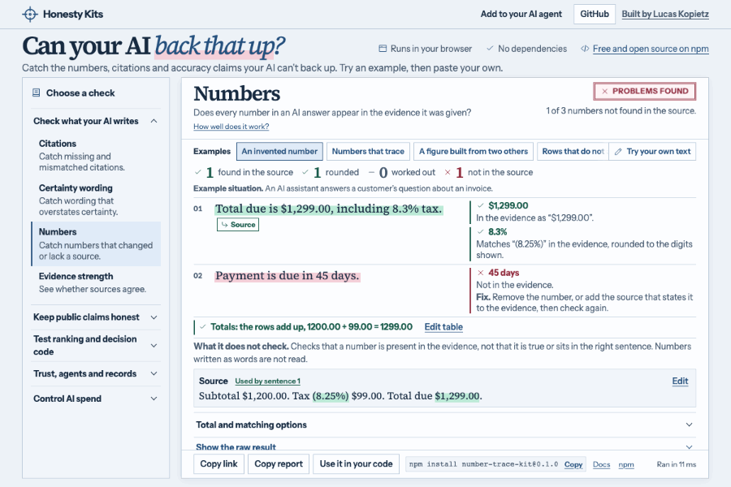

# honesty kits

Catch the numbers, citations and accuracy claims your AI can't back up. Small, dependency-free TypeScript checks for the claims your AI product makes.

[](https://lkopietz3-byte.github.io/honesty-kits/)

**[Try every kit in your browser →](https://lkopietz3-byte.github.io/honesty-kits/)**
Pick a check, try an example or paste your own text, and see the verdict, each sentence marked with what was found, a fix for each problem, what the check does not cover, and the code to run the same check in CI. The page runs the published npm builds in your browser. It serves those files itself and makes no third-party requests, and its Content-Security-Policy tells the browser to block requests to any other site.

## How well they work

These have a benchmark you can rerun from the repository (number-trace-kit downloads its public data first). Every figure below was printed by a fresh run of each repository's main branch on November 18, 2026. Most labels were written by the kits' author, so read each line as "the kit does what it documents on this data", not as a general accuracy rate.

- **[number-trace-kit](https://github.com/lkopietz3-byte/number-trace-kit/blob/main/README.md#accuracy-on-real-data)**: on 289 real AI answers from RAGTruth, whose annotators marked the made-up passages, the `strict` preset flagged 96 of the 106 numbers in those passages that are missing from the source, returned the other 10 as unknown for a person to check, passed none, and flagged 14 of 697 numbers outside them. A plain regex check catches about as many unsupported answers (74 of 75 against the kit's 71 of 75 on a 150-answer holdout). The kit's edge is fewer false flags on answers the annotators left unmarked (11 of 75 against 22 of 75), mostly on data-to-text answers.
- **[accuracy-claim-kit](https://github.com/lkopietz3-byte/accuracy-claim-kit/blob/main/README.md#agreement-with-an-independent-oracle-and-a-hand-labeled-holdout)**: its verdict matches a separately written oracle on 2,001 of 2,001 claims built from 216 rates printed in public FDA 510(k) summaries, and the hand label on 103 of 103 claims from 30 open-access papers and one vendor page. The oracle and the labels follow the README's rules and come from the same author, and only 6 of the 103 go through the interval math, so this shows the kit does what it documents, not that the rules are right.
- **[parity-kit](https://github.com/lkopietz3-byte/parity-kit/blob/main/README.md#accuracy-on-real-data)**: on a holdout labeled before the kit ever ran on it (IANA status phrases, SPDX licenses, Gitea strings), it missed 0 of 7,526 items that should flag and wrongly flagged 0 of 37,965 that should pass. The labels come from the author's own scripts and items from one file are correlated, so read the zero as no failures seen, not as a probability.

[grounding-kit](https://github.com/lkopietz3-byte/grounding-kit#readme), [provenance-kit](https://github.com/lkopietz3-byte/provenance-kit/blob/main/README.md#strict-mode-for-ci) and [trust-core](https://github.com/lkopietz3-byte/trust-core#readme) report smaller measured results in their own READMEs, including where they fail: a negation or a changed number often passes grounding-kit's word-overlap check. The other kits have tests for the behavior their READMEs document and a section on their limits, but no measured results yet. The playground marks those "Not benchmarked yet".

## The kits

There are 15 kits, each its own npm package, MIT licensed, with zero runtime dependencies and no network calls. Use one, or several. These are the kits in the playground. Plus honesty-mcp, a separate package that has tools for all 15 of them, for AI coding agents (see below).

### Check what your AI writes

| Kit | What it checks | Try it |
| --- | --- | --- |
| [grounding-kit](https://github.com/lkopietz3-byte/grounding-kit) | Does each sentence carry a citation that points at matching evidence? Flags missing citations, unknown source IDs and too little word overlap. | [playground](https://lkopietz3-byte.github.io/honesty-kits/#grounding-kit) |
| [provenance-kit](https://github.com/lkopietz3-byte/provenance-kit) | Does the copy sound more certain than its source allows ("independently verified", "guaranteed")? | [playground](https://lkopietz3-byte.github.io/honesty-kits/#provenance-kit) |
| [number-trace-kit](https://github.com/lkopietz3-byte/number-trace-kit) | Does every number in an AI answer appear in the evidence it was given, and do the rows add up to the printed total? | [playground](https://lkopietz3-byte.github.io/honesty-kits/#number-trace-kit) |
| [corroboration-kit](https://github.com/lkopietz3-byte/corroboration-kit) | How strong is the evidence for a claim, and does it point for or against it? | [playground](https://lkopietz3-byte.github.io/honesty-kits/#corroboration-kit) |

### Keep public claims honest

| Kit | What it checks | Try it |
| --- | --- | --- |
| [claims-registry-kit](https://github.com/lkopietz3-byte/claims-registry-kit) | Does each claim point at evidence that someone reviewed recently? | [playground](https://lkopietz3-byte.github.io/honesty-kits/#claims-registry-kit) |
| [accuracy-claim-kit](https://github.com/lkopietz3-byte/accuracy-claim-kit) | Do the counts behind an accuracy or error-rate figure carry it? Shows the interval the counts allow and a statement the evidence supports. | [playground](https://lkopietz3-byte.github.io/honesty-kits/#accuracy-claim-kit) |
| [parity-kit](https://github.com/lkopietz3-byte/parity-kit) | Does every copy of a fact still match its source, and did a review date move for a reason you can see in the data? | [playground](https://lkopietz3-byte.github.io/honesty-kits/#parity-kit) |
| [freshness-kit](https://github.com/lkopietz3-byte/freshness-kit) | How old is this information, and what should its "last reviewed" label say? | [playground](https://lkopietz3-byte.github.io/honesty-kits/#freshness-kit) |

### Test ranking and decision code

| Kit | What it checks | Try it |
| --- | --- | --- |
| [payout-invariance-kit](https://github.com/lkopietz3-byte/payout-invariance-kit) | Would your rankings change if a partner paid you more? | [playground](https://lkopietz3-byte.github.io/honesty-kits/#payout-invariance-kit) |
| [mutation-invariance-kit](https://github.com/lkopietz3-byte/mutation-invariance-kit) | Does a decision change when a field it should ignore (zip code, say) changes? | [playground](https://lkopietz3-byte.github.io/honesty-kits/#mutation-invariance-kit) |
| [advice-ledger-kit](https://github.com/lkopietz3-byte/advice-ledger-kit) | After someone followed a recommendation, did the problem actually get better? | [playground](https://lkopietz3-byte.github.io/honesty-kits/#advice-ledger-kit) |

### Trust, agents and records

| Kit | What it checks | Try it |
| --- | --- | --- |
| [trust-core](https://github.com/lkopietz3-byte/trust-core) | Do anonymous reviews look organic, or like a pattern worth a closer look? Plus credibility-weighted scores for known reviewers. | [playground](https://lkopietz3-byte.github.io/honesty-kits/#trust-core) |
| [agent-receipt-kit](https://github.com/lkopietz3-byte/agent-receipt-kit) | Did your AI agent stay inside what it was allowed to do, and do its claims match what you see? | [playground](https://lkopietz3-byte.github.io/honesty-kits/#agent-receipt-kit) |
| [audit-chain-kit](https://github.com/lkopietz3-byte/audit-chain-kit) | Has anyone edited or deleted entries in this log after the fact? | [playground](https://lkopietz3-byte.github.io/honesty-kits/#audit-chain-kit) |

### Control AI spend

| Kit | What it checks | Try it |
| --- | --- | --- |
| [cost-governor-kit](https://github.com/lkopietz3-byte/cost-governor-kit) | Will the next model call push you over budget? Cache-aware pricing and a pre-call ceiling. | [playground](https://lkopietz3-byte.github.io/honesty-kits/#cost-governor-kit) |

## Use them from your AI coding agent

[honesty-mcp](https://github.com/lkopietz3-byte/honesty-mcp) works with Claude Code, Cursor, VS Code and any other MCP client. Its tools cover fourteen kits by default and fifteen with its code-execution switch on (the switch adds the mutation-invariance-kit tool, which runs code you pass it). Thirteen of them run the check on what you give them. For the other two (agent receipts and spend caps) the tool explains the pattern and hands you starter code, because those kits run inside your own app. It runs on your machine with npx.

```bash
claude mcp add honesty-mcp -- npx -y honesty-mcp
```

[Add to VS Code](https://insiders.vscode.dev/redirect/mcp/install?name=honesty-mcp&config=%7B%22command%22%3A%22npx%22%2C%22args%22%3A%5B%22-y%22%2C%22honesty-mcp%22%5D%7D) · [Cursor and other clients](https://lkopietz3-byte.github.io/honesty-kits/#add-to-agent)

## How they behave

- **No dependencies, no network.** Each package ships plain ESM with types. Nothing phones home.
- **Strict about input.** Malformed input throws a clear error instead of producing a plausible wrong answer.
- **Honest about limits.** Every kit's README has a section on its limits, and every result in the playground says what the kit does not check. A structural citation check is not a fact check; passing a scenario test is evidence, not a proof.
- **Built to run in CI.** The playground's "Use it in your code" button gives you the same check as a module that exits with code 1 when it finds a problem.
- **Shareable.** "Copy link" (or Share on a phone, which opens the system share sheet) gives a link that opens the kit with your exact input, and copied reports include it. The example travels in the URL fragment, which browsers never send to a server.

## This repository

The playground is static HTML and three ES modules, with no bundler. `tools/build.mjs` wraps the page and copies in each kit's published files from `node_modules`; `npm ci` installs them from the lockfile, so they match the npm tarballs byte for byte. It also copies the vendored fonts (`static/fonts`, SIL Open Font License) and adds the Content-Security-Policy. The deploy workflow runs `npm audit signatures` before building.

```bash
npm ci             # installs the exact kit versions the page serves
npm test           # runs every example and every generated snippet against the real kits, then checks the build
node tools/build.mjs && npm run serve    # builds dist/, then serves it at http://127.0.0.1:8080/
```

`node tools/bump-kits.mjs <kit>@<version> ...` moves kits to new releases everywhere the site pins them (`demos.mjs`, `package.json` and the lockfile), then checks npm's signatures.

`node tools/rendered-check.mjs --playwright-root <path to playwright> --axe <path to axe-core>` loads the built page in a real browser at phone, tablet and desktop widths (light and dark) and checks every example, requests to other origins, focus, tap size and accessibility; it needs Playwright and axe-core installed somewhere and prints NOT_RUN without them.

`node tools/demo-gif.mjs --playwright-root <path to playwright>` re-records `docs/demo.gif` (pass `--url` to record a local build), and `node tools/og.mjs` renders the social card from `tools/og-card.html`.

MIT licensed.
