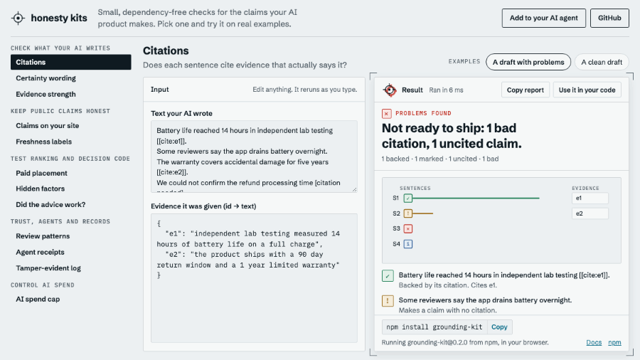

# Evidence Kit Playground

Checks that tie AI output and public claims back to their evidence. This is the in-browser playground for [Evidence Kit](https://github.com/evidencekit): small, dependency-free TypeScript checks for the claims your AI product makes.

[](https://evidencekit.github.io/)

**[Try every kit in your browser →](https://evidencekit.github.io/)**
Pick a kit, edit a real example, and see the verdict, a graphic of what it found, a fix for each problem and the code to run the same check in CI. The page runs the published npm builds in your browser (today under their former names, listed below). It serves those files itself and makes no third-party requests, and its Content-Security-Policy tells the browser to block requests to any other site.

## The kits

There are 12 kits, each its own npm package, MIT licensed, with zero runtime dependencies and no network calls. Use one, or several. Plus @evidencekit/mcp, a separate package that has tools for eleven of them, for AI coding agents (see below).

### Check what your AI writes

| Kit | What it checks | Try it |
| --- | --- | --- |
| [@evidencekit/citations](https://github.com/evidencekit/citations) | Does each sentence cite evidence that actually says it? Flags uncited claims and citations that point at the wrong evidence. | [playground](https://evidencekit.github.io/#grounding-kit) |
| [@evidencekit/wording](https://github.com/evidencekit/wording) | Does the copy sound more certain than its source allows ("independently verified", "guaranteed")? | [playground](https://evidencekit.github.io/#provenance-kit) |
| [@evidencekit/corroboration](https://github.com/evidencekit/corroboration) | How strong is the evidence for a claim, and does it point for or against it? | [playground](https://evidencekit.github.io/#corroboration-kit) |

### Keep public claims honest

| Kit | What it checks | Try it |
| --- | --- | --- |
| [@evidencekit/claims](https://github.com/evidencekit/claims) | Is every claim on your site still backed by evidence someone checked recently? | [playground](https://evidencekit.github.io/#claims-registry-kit) |
| [@evidencekit/freshness](https://github.com/evidencekit/freshness) | How old is this information, and what should its "last reviewed" label say? | [playground](https://evidencekit.github.io/#freshness-kit) |

### Test ranking and decision code

| Kit | What it checks | Try it |
| --- | --- | --- |
| [@evidencekit/payout-invariance](https://github.com/evidencekit/payout-invariance) | Would your rankings change if a partner paid you more? | [playground](https://evidencekit.github.io/#payout-invariance-kit) |
| [@evidencekit/input-invariance](https://github.com/evidencekit/input-invariance) | Does a decision change when a field it should ignore (zip code, say) changes? | [playground](https://evidencekit.github.io/#mutation-invariance-kit) |
| [@evidencekit/advice-ledger](https://github.com/evidencekit/advice-ledger) | After someone followed a recommendation, did the problem actually get better? | [playground](https://evidencekit.github.io/#advice-ledger-kit) |

### Trust, agents and records

| Kit | What it checks | Try it |
| --- | --- | --- |
| [@evidencekit/reputation](https://github.com/evidencekit/reputation) | Do anonymous reviews look organic, or like a pattern worth a closer look? Plus credibility-weighted scores for known reviewers. | [playground](https://evidencekit.github.io/#trust-core) |
| [@evidencekit/agent-receipts](https://github.com/evidencekit/agent-receipts) | Did your AI agent stay inside what it was allowed to do, and do its claims match what you see? | [playground](https://evidencekit.github.io/#agent-receipt-kit) |
| [@evidencekit/audit-chain](https://github.com/evidencekit/audit-chain) | Has anyone edited or deleted entries in this log after the fact? | [playground](https://evidencekit.github.io/#audit-chain-kit) |

### Control AI spend

| Kit | What it checks | Try it |
| --- | --- | --- |
| [@evidencekit/spend-limits](https://github.com/evidencekit/spend-limits) | Will the next model call push you over budget? Cache-aware pricing and a pre-call ceiling. | [playground](https://evidencekit.github.io/#cost-governor-kit) |

### Formerly published under other names

The packages above moved to the `@evidencekit` scope. Each was formerly published under the name shown here.

- `@evidencekit/citations`: formerly `grounding-kit`
- `@evidencekit/wording`: formerly `provenance-kit`
- `@evidencekit/corroboration`: formerly `corroboration-kit`
- `@evidencekit/claims`: formerly `claims-registry-kit`
- `@evidencekit/freshness`: formerly `freshness-kit`
- `@evidencekit/payout-invariance`: formerly `payout-invariance-kit`
- `@evidencekit/input-invariance`: formerly `mutation-invariance-kit`
- `@evidencekit/advice-ledger`: formerly `advice-ledger-kit`
- `@evidencekit/reputation`: formerly `trust-core`
- `@evidencekit/agent-receipts`: formerly `agent-receipt-kit`
- `@evidencekit/audit-chain`: formerly `audit-chain-kit`
- `@evidencekit/spend-limits`: formerly `cost-governor-kit`
- `@evidencekit/mcp`: formerly `honesty-mcp`

## Use them from your AI coding agent

[@evidencekit/mcp](https://github.com/evidencekit/mcp) has tools for eleven of the 12 kits, for Claude Code, Cursor, VS Code and any other MCP client. Nine of them run the check on what you give them. For the other two (agent receipts and spend caps) the tool explains the pattern and hands you starter code, because those kits run inside your own app. It runs on your machine with npx.

```bash
claude mcp add evidencekit -- npx -y @evidencekit/mcp
```

[Add to VS Code](https://insiders.vscode.dev/redirect/mcp/install?name=evidencekit&config=%7B%22command%22%3A%22npx%22%2C%22args%22%3A%5B%22-y%22%2C%22%40evidencekit%2Fmcp%22%5D%7D) · [Cursor and other clients](https://evidencekit.github.io/#add-to-agent)

## How they behave

- **No dependencies, no network.** Each package ships plain ESM with types. Nothing phones home.
- **Strict about input.** Malformed input throws a clear error instead of producing a plausible wrong answer.
- **Honest about limits.** Every kit's README has a section on its limits, and every result in the playground says what the kit does not check. A structural citation check is not a fact check; passing a scenario test is evidence, not a proof.
- **Built to run in CI.** The playground's "Use it in your code" button gives you the same check as a module that exits with code 1 when it finds a problem.
- **Shareable.** "Copy link" (or Share on a phone, which opens the system share sheet) gives a link that opens the kit with your exact input, and copied reports include it. The example travels in the URL fragment, which browsers never send to a server.

## This repository

This repository is the Evidence Kit Playground, served from https://evidencekit.github.io/ (repository `evidencekit/evidencekit.github.io`). It was previously published at lkopietz3-byte.github.io/honesty-kits. Until the scoped packages are published, the page keeps loading the packages under their former names, and its links to a single kit (the `#grounding-kit` style anchors) keep using those names so old shared links still open. The playground is static HTML and three ES modules, with no bundler. `tools/build.mjs` wraps the page and copies in each kit's published files from `node_modules`; `npm ci` installs them from the lockfile, so they match the npm tarballs byte for byte. It also copies the vendored fonts (`static/fonts`, SIL Open Font License) and adds the Content-Security-Policy. The deploy workflow runs `npm audit signatures` before building.

```bash
npm ci             # installs the exact kit versions the page serves
npm test           # runs every example and every generated snippet against the real kits, then checks the build
node tools/build.mjs && npm run serve    # builds dist/, then serves it at http://127.0.0.1:8080/
```

`node tools/bump-kits.mjs <kit>@<version> ...` moves kits to new releases everywhere the site pins them (`demos.mjs`, `package.json` and the lockfile), then checks npm's signatures.

`node tools/rendered-check.mjs --playwright-root <path to playwright> --axe <path to axe-core>` loads the built page in a real browser at phone, tablet and desktop widths (light and dark) and checks every example, requests to other origins, focus, tap size and accessibility; it needs Playwright and axe-core installed somewhere and prints NOT_RUN without them.

`node tools/demo-gif.mjs --playwright-root <path to playwright>` re-records `docs/demo.gif` from the live site, and `tools/og.mjs` re-captures the social card.

MIT licensed.
